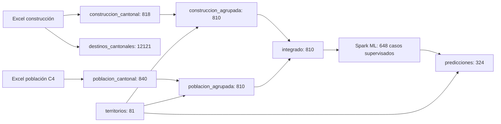
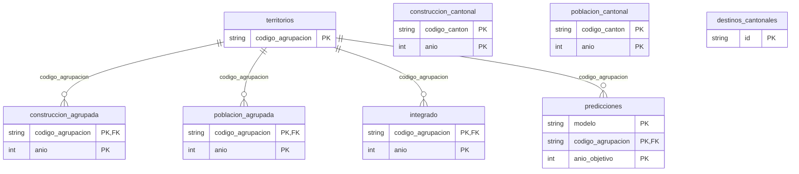
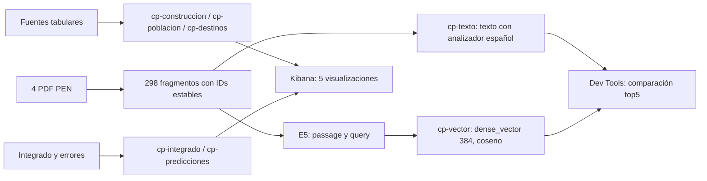

# Estructuras, relaciones y diccionario

Los códigos territoriales se conservan como texto. El campo año es un entero; el grano del integrado es agrupación-año. Las claves y restricciones reales se documentan en `sql/Esquema.sql`.

La relación entre fuentes anteriores al cruce es lógica por código y año; no se declara una FK que falsamente presuponga que ambas cubren exactamente los mismos cantones. La agrupación suma 216 a 203, 612 a 601 y 613 a 607 antes de cruzar. Un territorio agrupado no se interpreta como el cantón administrativo actual.

| Campos | Tipo / unidad | Uso |
|---|---|---|
| codigo_canton, canton | texto | Identidad original de la fuente |
| codigo_agrupacion, agrupacion, provincia | texto | Geografía armonizada para la comparación |
| anio | entero | Año de referencia del agregado o del objetivo |
| obras_total, obras_nuevas, obras_ampliacion, obras_reparacion | entero largo | Cantidad de obras autorizadas |
| area_m2, area_nueva_m2, area_ampliacion_m2 | doble, m² | Área nueva más ampliada; no agrega área de reparación |
| valor_miles_colones, valor_nueva_miles, valor_ampliacion_miles, valor_reparacion_miles | doble, miles de colones corrientes | Valores nominales conservados, no usados para predecir |
| poblacion, hombres, mujeres | doble, personas estimadas/proyectadas | Serie de C4; se conservan decimales originales |
| area_por_habitante | doble, m²/persona | Área del año entre población del mismo año |
| destino, categoria, nivel | texto | Distingue detalle y subtotal_categoria; no sumar ambos |
| archivo, hoja, fila, fuente_url, columnas_metricas | texto / entero | Trazabilidad del Excel y columnas leídas |
| codigos_*, origen_* | texto | Miembros y procedencia de la agrupación |
| observado_m2, prediccion_m2, error_m2, error_absoluto_m2 | doble, m² | Prueba final; error = predicción menos observado |
| anio_datos, anio_objetivo | entero | En predicciones: último año de atributos y año objetivo; anio_datos = anio_objetivo - 1 |

Los 11 indicadores de construcción se preservan antes y después del cruce. Las marcas `-`, `.`, `N.D` y vacíos permanecen nulas, sin convertirlas en cero. Se identificaron 312 celdas `N.D` de 2019 y una `N` aislada en obras_reparacion, fila 1413 del Excel 2020 (Coto Brus, Otros destinos). Esta última se conserva cruda y queda nula mediante una excepción limitada a esa celda; no se infiere su valor. `output/auditoria_signos.json` deja evidencia de los 313 casos. Otros símbolos desconocidos, valores negativos y conteos fraccionarios se rechazan. La hoja 2016 tiene separadores desplazados: la selección depende de encabezados, no de posiciones idénticas asumidas.

## Elasticsearch

Cada mapping JSON es completo y estricto (`dynamic: strict`). Códigos y categorías son keyword, magnitudes son numéricas y fecha es date. Los textos tienen analizador `spanish`; `cp-vector` añade `embedding`, dense_vector indexado de 384 componentes con similitud coseno. Cada fragmento conserva título, documento, autor, año, página PDF, tipo, hashes y coordenadas de caracteres. No hay FK entre texto y los datos INEC: son una rama documental independiente.

`fecha` representa el inicio del año de referencia en Costa Rica (UTC-6), codificado con `06:00:00Z`. No es la fecha individual de un permiso. Las consultas exactas, nombres y tipos de cada campo se pueden inspeccionar con `GET cp-integrado/_mapping` y `GET cp-vector/_mapping`.
